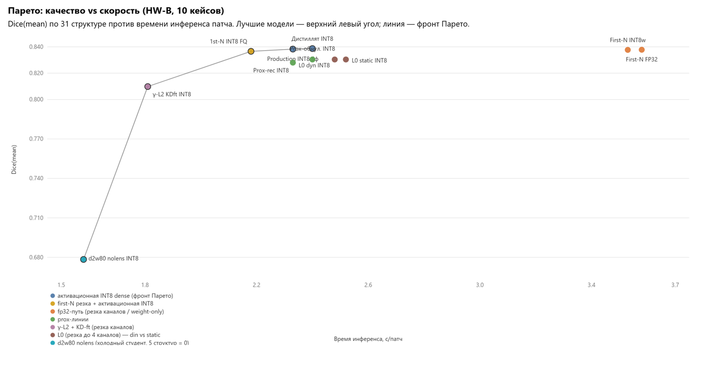

# Замеры качества и скорости моделей (BENCHMARKS)

Живой журнал результатов замеров. **Правило консистентности: сравнивать между собой можно только строки с одинаковым `HW`-профилем** (см. «Железо» ниже) и одинаковыми настройками инференса. Замеры делаются на разных машинах — каждая строка обязана ссылаться на HW-ID, дату и настройки.

## Методология

- **Валидационный набор:** 10 внешних кейсов `validation_DICOM_0001…0010` (не участвовали ни в обучении учителей, ни в дистилляции); КТ — `validation\headandneck\GT\imagesTr`, GT — `labelsTr`.
- **Метрика:** Dice по каждой из 31 структур (словарь `LABELS` в `radonc_segmentation/config.py`); органы, отсутствующие в обеих масках, исключаются; `Dice(mean)` = среднее по присутствующим органам кейса, затем среднее по 10 кейсам.
- **Настройки инференса (все валидационные замеры):** `VARIANT=aligned`, `stride 0.5`, `CROP_AIR=on`, `ACCUMULATOR=disk`, `PERFORMANCE_HINT=LATENCY`, `N_ASYNC=2`, фолды — как указано в строке.
- **Инструмент:** `python -m radonc_segmentation.quantization.validate_model --model <имя> --n 10` (CSV в `logs\validate\`, сегменты в `validation\headandneck\<кейс>\seg_nnunet`); на автономной машине — офлайн-валидатор legacy `scripts\validate_model.py --model <путь>` (результаты в папке модели + md5-инспекция весов, см. секцию HW-B ниже).
- Модель учителей: nnUNet-ансамбль 5 фолдов; прогнозы получены на Kaggle (`nnUNetv2 predict`), наша метрика посчитана на них локально и сходится с `summary.json` nnUNet один в один.

## Железо (HW-профили)

| ID | Машина | CPU | ОЗУ | GPU | ПО | Потоки |
|---|---|---|---|---|---|---|
| **HW-A** | Ноутбук ASUS (основная машина с 2026-10-02) | Intel Core i5-11300H (4C/8T) | 7.7 ГБ | Iris Xe (рендер); RTX 3050 Laptop 4 ГБ **отключена с 2026-10-11** (серия BSOD `nvlddmkm`) — все валидационные замеры ниже сделаны в этой конфигурации | Win11; OpenVINO 2025.2.0, Python 3.10.22; torch 2.8.0+cpu, nncf 2.19.0 (квантизация) | 8 логических |
| **HW-B** | Прод-машина MSK-D26-9245 (автономная, без интернета) | Intel Core i5-9400T (6C/6T) | 16 ГБ | UHD 630 (не используется) | Win10 1909; OpenVINO 2025.2.0, Python 3.10.19 | 6 |
| **HW-KC** | Kaggle, CPU-ядро | 4 vCPU (Xeon) | ~30 ГБ | — | Python 3.13; OpenVINO 2025.2.0, torch 2.11.0+cpu, nncf 2.19.0 | 4 vCPU |
| **HW-KG** | Kaggle, GPU-ядро | — | — | Tesla T4 ×2 | nnUNetv2 (predict / дистилляция) | — |

## Основные результаты (валидация, 10 кейсов)

| Дата | HW | Модель | Архитектура | Фолды | Калибровка INT8 | Dice(mean) | Время, мин/кейс | CSV |
|---|---|---|---|---|---|---|---|---|
| 2026-10-11/12 | HW-A | Дистиллят INT8 | ResEncUNet-M dense [32,64,128,256,320,320], эпоха 199 | 1 | 2 патча | **0.8394** | **6.0** | `validate_20261012_002723.csv` |
| 2026-10-12 | HW-A | Дистиллят FP32 | тот же, без квантизации | 1 | — | 0.8407 | 8.9 | `validate_20261012_043755.csv` |
| 2026-10-12 | HW-A | Production INT8 | ResEncUNet-M dense, ансамбль | 5 | 24 патча (2026-10-05) | 0.8398 | 15.1 | `validate_20261012_030659.csv` |
| 2026-10-12 | HW-A | Оригинал FP32 (только тайминг) | ResEncUNet-M dense, ансамбль | 5 | — | не измерен (≈4 ч на 10 кейсов; это плотный исходник, из которого квантизован production INT8) | 24.1 (**1 кейс**, вариант legacy) | `logs\infer_log.csv`, строка 2026-10-12 05:02 |
| 2026-10-16 | HW-A | Pruned FP32 | ResEncUNet-M pruned [32,58,115,256,256,256], RecoveryKD e60 | 1 | — | 0.8288 | 16.3 | `validate_20261016_113322.csv` |
| 2026-10-16 | HW-A | Pruned INT8 | ResEncUNet-M pruned [32,58,115,256,256,256], RecoveryKD эпоха 60 | 1 | 48 патчей (Kaggle, HW-KC) | 0.8275 | 8.2 | `validate_20261016_093852.csv` |
| 2026-10-10/11 | HW-KG | Учителя (ансамбль — верхний ориентир) | ResEncUNet-M dense ×5 | 5 | — | **0.8447** | — (Kaggle GPU) | `results (4).zip` → `predictions/summary.json` |

## Прогоны HW-B (MSK-D26-9245), 2026-10-29/30 — автономный валидатор



Первый прогон офлайн-валидатора (legacy `scripts\validate_model.py`) на прод-машине: 6 моделей × 10 кейсов за один цикл. Каждый прогон оставил в папке модели `validation_log.txt`, `validation_dice.csv`, `validation_timing.csv`, `model_inspection.json` (md5 весов, каналы, квантизация); копия — `logs\validate\hwb_msk_20261030\`. Дополнительно 2026-11-02 тем же валидатором и настройками: `gamma_l2_kdft_INT8` (13:06) и `first_N_pruned_INT8` с активационной INT8 (15:42); копии — `logs\validate\hwb_msk_20261102\`.

**Настройки отличаются от стандарта** (взяты из settings.ini той машины): `stride 0.65` (не 0.5), `N_ASYNC=6` (не 2), `ACCUMULATOR=ram` (не disk). Остальное — стандарт (aligned, кроп on, LATENCY, batch 1, 6 потоков). Внутри секции все строки сравнимы между собой; с HW-A прямого сравнения нет, но повторно протестированные модели сошлись с HW-A в пределах ±0.002.

Идентификация по `model_inspection.json` (md5 сверены с весами в репо):

| Папка из архива | Модель в репо | Проверка |
|---|---|---|
| `5fold_INT8` | `original_int8_5fold` | md5 совпадает |
| `distilled_int8` | `distilled_int8` | md5 совпадает |
| `first_N_pruned_fp32` | `firstn_pruned_fp32` | md5 совпадает |
| `first_N_pruned_INT8weights` | `firstn_pruned_int8` | md5 **не** совпадает — другой экспорт той же линии; bin 37.6 МБ, FakeQuantize=0 → weight-only INT8-веса (считается по fp32-пути) |
| `prox_pruned_INT8` | `prox_pruned_recovered_int8` | md5 **не** совпадает — другой экспорт; каналы [32,58,115,256] подтверждают резку+recovery, SpinalCord 0.8427 живой |
| `prox_pruned_norecovery_INT8` | `prox_pruned_int8` | md5 совпадает; dense-каналы (резки не было), INT8 с 100-патч калибровкой (`quantized_model_100p.xml`) |
| `gamma_l2_kdft_INT8\fold_0` (прогон 2026-11-02) | новой линии в репо нет | INT8 48p (FakeQuantize 161), bin 48.3 МБ (−53% весов к дистилляту), md5(bin) 40dce049…; каналы [26, 45–55, 94–113, 156–223, 320] = резка ≈20% stem/enc1/enc2 + частично enc3, enc4/5 целы — γ-L2+KDft линия (SCAN-семейство) |
| `first_N_pruned_INT8\fold_0` (прогон 2026-11-02) | дополнение к `firstn_pruned_int8` | **активационная INT8** 48p (FakeQuantize 161), bin 37.6 МБ, md5(bin) c56e8db2…; та же резка [32,64,128,160,192], что и weight-only `first_N_pruned_INT8weights` от 30.10 — пара образует чистый A/B weight-only vs активационной квантизации на одной архитектуре |

### Результаты (HW-B, stride 0.65, async 6, ram)

| Дата | Модель | Архитектура | Фолды | Dice(mean) | мин/кейс | с/патч |
|---|---|---|---|---|---|---|
| 2026-10-29 | Дистиллят INT8 | dense [32,64,128,256,320] | 1 | **0.8387** | **2.1** | 2.40 |
| 2026-10-30 | Production INT8 | dense, ансамбль | 5 | 0.8383 | 9.7 | 2.33 |
| 2026-10-29 | First-N pruned FP32 | [32,64,128,160,192] | 1 | 0.8378 | 3.0 | 3.58 |
| 2026-10-30 | First-N pruned, INT8-веса | тот же, weight-only INT8 | 1 | 0.8377 | 3.0 | 3.53 |
| 2026-10-30 | Prox-обнуление INT8 (100p калибровка) | dense, без резки | 1 | 0.8304 | 2.1 | 2.40 |
| 2026-10-29 | Prox-pruned recovered INT8 | резка [32,58,115,256] + recovery | 1 | 0.8280 | 2.0 | 2.33 |
| 2026-11-02 | γ-L2 KDft INT8 (резка ≈20% stem/enc1/2) | pruned + INT8 48p, bin 48 МБ (−53% весов) | 1 | 0.8098 | **1.6** | **1.81** |
| 2026-11-02 | First-N pruned INT8 (активационная FQ) | [32,64,128,160,192], INT8 48p | 1 | 0.8366 | 1.9 | 2.18 |
| 2026-11-03 | L0 dyn INT8 (ε-резка SCAN-4 k20, глубокие стадии) | 36.6M параметров, [30,31,30,63,128,156→…,320] см. вывод 8, INT8 48p dyn | 1 | 0.8304 | 2.1 | 2.48 |
| 2026-11-03 | L0 static INT8 (та же архитектура, static квант) | идентичная, INT8 48p static | 1 | 0.8304 | 2.2 | 2.52 |
| 2026-11-05 | d2w80 nolens INT8 (холодный студент, 5 структур не предсказываются) | [32,64,80], bin 5.7 МБ (−94% весов) | 1 | 0.6784* | **1.4** | **1.58** |

### По кейсам (Dice, HW-B)

| Кейс | 5fold INT8 | Дистиллят INT8 | 1st-N FP32 | 1st-N INT8w | Prox-rec INT8 | Prox-обнул INT8 | γ-L2 KDft INT8 | 1st-N INT8 FQ | L0 dyn INT8 | L0 static INT8 | d2w80 nolens |
|---|---|---|---|---|---|---|---|---|---|---|---|---|
| validation_DICOM_0001 | 0.7500 | 0.7432 | 0.7427 | 0.7424 | 0.7308 | 0.7448 | 0.7115 | 0.7392 | 0.7345 | 0.7345 | 0.6247 |
| validation_DICOM_0002 | 0.8551 | 0.8492 | 0.8475 | 0.8472 | 0.8354 | 0.8390 | 0.8289 | 0.8483 | 0.8410 | 0.8410 | 0.6882 |
| validation_DICOM_0003 | 0.8508 | 0.8540 | 0.8547 | 0.8548 | 0.8479 | 0.8499 | 0.8307 | 0.8516 | 0.8432 | 0.8432 | 0.6912 |
| validation_DICOM_0004 | 0.8547 | 0.8531 | 0.8533 | 0.8534 | 0.8452 | 0.8358 | 0.8263 | 0.8519 | 0.8448 | 0.8448 | 0.6777 |
| validation_DICOM_0005 | 0.8201 | 0.8200 | 0.8150 | 0.8154 | 0.8143 | 0.8153 | 0.7983 | 0.8140 | 0.8299 | 0.8299 | 0.6510 |
| validation_DICOM_0006 | 0.8262 | 0.8431 | 0.8381 | 0.8379 | 0.8234 | 0.8209 | 0.8072 | 0.8381 | 0.8235 | 0.8235 | 0.6572 |
| validation_DICOM_0007 | 0.8501 | 0.8472 | 0.8486 | 0.8480 | 0.8374 | 0.8456 | 0.8165 | 0.8479 | 0.8373 | 0.8373 | 0.6906 |
| validation_DICOM_0008 | 0.8403 | 0.8351 | 0.8359 | 0.8363 | 0.8225 | 0.8341 | 0.7975 | 0.8366 | 0.8279 | 0.8279 | 0.6769 |
| validation_DICOM_0009 | 0.8717 | 0.8726 | 0.8730 | 0.8729 | 0.8593 | 0.8628 | 0.8462 | 0.8718 | 0.8626 | 0.8626 | 0.7093 |
| validation_DICOM_0010 | 0.8644 | 0.8693 | 0.8695 | 0.8693 | 0.8636 | 0.8558 | 0.8352 | 0.8670 | 0.8592 | 0.8592 | 0.7169 |
| **Среднее** | **0.8383** | **0.8387** | **0.8378** | **0.8377** | **0.8280** | **0.8304** | **0.8098** | **0.8366** | **0.8304** | **0.8304** | **0.6784*** |

### По органам (Dice, среднее за 10 кейсов, HW-B)

| Орган | 5fold INT8 | Дистиллят INT8 | 1st-N FP32 | 1st-N INT8w | Prox-rec INT8 | Prox-обнул INT8 | γ-L2 KDft INT8 | 1st-N INT8 FQ | L0 dyn INT8 | L0 static INT8 | d2w80 nolens |
|---|---|---|---|---|---|---|---|---|---|---|
| BrachialPlexus_R | 0.6603 | 0.6643 | 0.6534 | 0.6531 | 0.6569 | 0.6203 | 0.6071 | 0.6481 | 0.6506 | 0.6506 | 0.6135 |
| BrachialPlexus_L | 0.7281 | 0.7398 | 0.7421 | 0.7427 | 0.7283 | 0.7389 | 0.6855 | 0.7419 | 0.7096 | 0.7096 | 0.6886 |
| SpinalCanal | 0.8753 | 0.8730 | 0.8801 | 0.8799 | 0.8687 | 0.8789 | 0.8599 | 0.8790 | 0.8636 | 0.8636 | 0.8770 |
| SpinalCord | 0.8563 | 0.8512 | 0.8538 | 0.8533 | 0.8427 | 0.8529 | 0.8299 | 0.8527 | 0.8390 | 0.8390 | 0.8409 |
| Trachea | 0.9285 | 0.9264 | 0.9244 | 0.9246 | 0.9208 | 0.9064 | 0.8989 | 0.9238 | 0.9202 | 0.9202 | 0.9051 |
| Esophagus | 0.8745 | 0.8920 | 0.8885 | 0.8885 | 0.8860 | 0.8859 | 0.8670 | 0.8878 | 0.8834 | 0.8834 | 0.8201 |
| Thyroid | 0.7998 | 0.8202 | 0.8140 | 0.8143 | 0.8088 | 0.7966 | 0.7679 | 0.8153 | 0.8064 | 0.8064 | 0.7648 |
| A_Carotid_R | 0.7388 | 0.7507 | 0.7421 | 0.7418 | 0.7320 | 0.7229 | 0.6396 | 0.7341 | 0.7179 | 0.7179 | 0.6018 |
| A_Carotid_L | 0.7803 | 0.7661 | 0.7656 | 0.7655 | 0.7442 | 0.7504 | 0.6957 | 0.7628 | 0.7606 | 0.7606 | 0.6382 |
| Larynx | 0.9011 | 0.9130 | 0.9128 | 0.9126 | 0.9067 | 0.8957 | 0.8793 | 0.9111 | 0.9099 | 0.9099 | 0.9003 |
| PharynxConst_I | 0.8495 | 0.8559 | 0.8528 | 0.8529 | 0.8344 | 0.8512 | 0.8254 | 0.8526 | 0.8496 | 0.8496 | 0.8188 |
| PharynxConst_M | 0.7612 | 0.7409 | 0.7307 | 0.7300 | 0.7013 | 0.7326 | 0.7169 | 0.7314 | 0.7385 | 0.7385 | 0.7023 |
| PharynxConst_S | 0.7150 | 0.7141 | 0.7064 | 0.7065 | 0.6701 | 0.7148 | 0.6743 | 0.7082 | 0.7326 | 0.7326 | 0.6872 |
| OpticNerve_R | 0.8061 | 0.7967 | 0.7977 | 0.7977 | 0.7734 | 0.7974 | 0.7537 | 0.7978 | 0.7754 | 0.7754 | 0.0000 |
| OpticNerve_L | 0.7948 | 0.7909 | 0.7977 | 0.7980 | 0.7769 | 0.7939 | 0.7564 | 0.7996 | 0.7771 | 0.7771 | 0.0000 |
| Brain | 0.9936 | 0.9931 | 0.9928 | 0.9927 | 0.9926 | 0.9919 | 0.9907 | 0.9928 | 0.9913 | 0.9913 | 0.9914 |
| Submandibular_R | 0.8592 | 0.8705 | 0.8714 | 0.8717 | 0.8661 | 0.8566 | 0.8467 | 0.8717 | 0.8648 | 0.8648 | 0.8513 |
| Submandibular_L | 0.8230 | 0.8137 | 0.8185 | 0.8188 | 0.8101 | 0.8232 | 0.8006 | 0.8162 | 0.8115 | 0.8115 | 0.8031 |
| Parotid_R | 0.8868 | 0.8938 | 0.8951 | 0.8949 | 0.8844 | 0.8800 | 0.8730 | 0.8891 | 0.8840 | 0.8840 | 0.8807 |
| Parotid_L | 0.8923 | 0.8867 | 0.8847 | 0.8846 | 0.8808 | 0.8843 | 0.8750 | 0.8822 | 0.8831 | 0.8831 | 0.8776 |
| Lips | 0.7941 | 0.7881 | 0.7854 | 0.7860 | 0.7852 | 0.7664 | 0.7479 | 0.7861 | 0.7783 | 0.7783 | 0.7859 |
| Tongue | 0.9270 | 0.9265 | 0.9260 | 0.9260 | 0.9251 | 0.9154 | 0.9202 | 0.9259 | 0.9246 | 0.9246 | 0.9198 |
| Mandible | 0.9594 | 0.9602 | 0.9587 | 0.9586 | 0.9540 | 0.9383 | 0.9413 | 0.9587 | 0.9523 | 0.9523 | 0.9539 |
| Eye_R | 0.9143 | 0.9117 | 0.9135 | 0.9136 | 0.9098 | 0.9144 | 0.9095 | 0.9143 | 0.9081 | 0.9081 | 0.8976 |
| Lens_R | 0.8274 | 0.8089 | 0.8087 | 0.8071 | 0.8051 | 0.8112 | 0.7951 | 0.8063 | 0.7910 | 0.7910 | 0.0000 |
| Eye_L | 0.9393 | 0.9419 | 0.9412 | 0.9414 | 0.9329 | 0.9358 | 0.9241 | 0.9418 | 0.9338 | 0.9338 | 0.9091 |
| Lens_L | 0.8557 | 0.8534 | 0.8591 | 0.8596 | 0.8587 | 0.8451 | 0.8463 | 0.8620 | 0.8514 | 0.8514 | 0.0000 |
| TMJoint_R | 0.7721 | 0.7965 | 0.7953 | 0.7956 | 0.7587 | 0.7703 | 0.7501 | 0.7932 | 0.8037 | 0.8037 | 0.7228 |
| TMJoint_L | 0.8022 | 0.8140 | 0.8059 | 0.8056 | 0.7996 | 0.8132 | 0.7998 | 0.8010 | 0.8011 | 0.8011 | 0.7687 |
| Cochlea_R | 0.8449 | 0.8235 | 0.8250 | 0.8268 | 0.8286 | 0.8299 | 0.8178 | 0.8234 | 0.8096 | 0.8096 | 0.8091 |
| Cochlea_L | 0.8272 | 0.8212 | 0.8285 | 0.8255 | 0.8248 | 0.8271 | 0.8098 | 0.8252 | 0.8188 | 0.8188 | 0.0000 |

### Выводы (HW-B, 2026-10-29/30)

1. **Дистиллят INT8 подтверждён как прод и на второй машине:** 0.8387 при 2.1 мин/кейс — качество на уровне 5-фолдового ансамбля (0.8383; дистиллят выигрывает 4 кейса, проигрывает 6, разница в пределах шума) при скорости в 4.7× выше.
2. **First-N pruned не догоняет дистиллят по скорости:** 0.8377 (−0.001, шум) при 3.0 мин/кейс. INT8-веса weight-only не ускоряют свёртки (3.53 с/патч = FP32 3.58): ускорение на CPU OpenVINO даёт только активационная квантизация (FakeQuantize/VNNI: 2.3–2.4 с/патч против 3.5–3.6 у fp32-пути, независимо от резки каналов).
3. **Prox-линии ниже дистиллята:** recovered 0.8280 (−0.011), обнуление 0.8304 (−0.008); просадка сосредоточена в PharynxConst_M/S, A_Carotid, у обнуления ещё Mandible/Trachea. Prox-обнуление с 100-патч калибровкой улучшило старую HW-A цифру 0.8214 → 0.8304 (другой экспорт INT8).
4. **SpinalCord жив у всех моделей** (0.842–0.856), включая физически резанную prox-recovered — в отличие от failed-прогона prox-rec 0.7918/SpinalCord=0 из истории.
5. **Консистентность железа:** дистиллят 0.8394 (HW-A, stride 0.5) vs 0.8387 (HW-B, stride 0.65) — модель ведёт себя одинаково на обоих HW.
6. **γ-L2+KDft (SCAN-семейство, прогон 2026-11-02)**: самая быстрая модель на HW-B — 1.81 с/патч (−25% к дистилляту), веса −53% — но Dice 0.8098 (−0.029 к дистилляту) ниже всех; просадка в средних/малых структурах (A_Carotid_R −0.111, Thyroid −0.052, BrachialPlexus_R −0.057, TMJoint_R −0.046 — гейт малых структур провален) + аномалия Thyroid=0.17 на кейсе 0006. Расширяет Парето-фронт как точка «быстро/легко», но прод-гейту не проходит; прод остаётся дистиллят+INT8.
7. **A/B: weight-only vs активационная INT8 на одной first-N архитектуре [32,64,128,160,192]** (прогоны 30.10 vs 02.11): weight-only (FakeQuantize=0) — 3.53 с/патч, fp32-скорость; активационная FQ-версия — **2.18 с/патч (−38%)** при Dice 0.8366 (+0.000 к weight-only, внутри шума). Окончательно: ускорение на CPU OpenVINO даёт только FakeQuantize-слои (VNNI), weight-only INT8 бесполезен. При этом 0.8366 всё равно чуть ниже дистиллята-INT8 0.8387 при сопоставимой скорости (2.18 vs 2.40) — дистиллят остаётся продом, first-N FQ — лучший fallback-вариант.

8. **L0 (SCAN-4 k20 stage_a → ε-резка) — динамическая vs статическая INT8** (прогон 2026-11-03, обе 0.8304): **динамическая INT8 быстрее на 0.04 с/патч (2.48 vs 2.52)** — разница в пределах шума, качество бит-в-бит одинаковое (0.8304). Линия: `scan4_SCAN_k20_stage_a.pth` → ε-резка (|γ|<ε, пол 4 кан/слой) → rebuild → OV-экспорт (dynamo) → FQ48. **Геометрия по IR (замер 11-03, `kaggle\l0_probe\probe_l0_geometry.py`): 36.63M параметров (−64% к 101.6M), но 718.3 GMACs (−2.2% к dense 733.8)** — вся резка в глубокой стадии S3 7×24×24 (42 conv: enc5 → шесть 4-канальных слоёв (пол), enc4 → 156/125; в S3 живёт 85% параметров и лишь 14% MACs), ранние стадии почти целы (stem 32→30/31, enc1 64→63, S2 dense). 86% MACs сидит в S0–S2 (244.8+227.2+144.2) → **параметры −64% не конвертируются в латентность**: 2.48 vs 2.40 с/патч у дистиллята-INT8 (+3%, шум). Качество 0.8304 ниже дистиллята-INT8 на 0.0083; гейт малых структур провален (A_Carotid_R −0.033, BrachialPlexus_L −0.030 к дистилляту HW-B), SpinalCord жив (0.8390); TMJoint_R (+0.007) и PharynxConst_S (+0.019) даже улучшились. На Парето-фронт не попадает (first-N FQ 0.8366@2.18 лучше по обеим осям). Вывод: **резка ради скорости на CPU обязана целить в S0–S2 (86% MACs)**; γ-селекция на тёплом старте режет MACs-дешёвые глубокие стадии — k=30/cold-варианты обязаны это проверить.

9. **Абляция квантизации L0 (HW-KC, Kaggle CPU 4 vCPU, nncf 2.19 + OV 2025.2, ядро quant-ablation, `l0_a0a3_report.json` 2026-11-02)**: fp32-dyn 8.39 с/патч → FQ48-dyn 4.71 (**1.78×**, dice-дельта −0.0022), FQ256-dyn 4.66 (**1.80×**, −0.0012 — 256-патч калибровка чуть точнее при той же скорости), FQ48 на статическом IR 4.68 (1.795×; сам статический IR медленнее динамического — 0.964×), weight-only 8.40 (0.999× — ускорения нет, независимо подтверждает вывод 7). Судья 3 патчей: все FQ-варианты ≤0.001 от fp32. Ядро упало в ACC-плече (accuracy-aware NNCF, DeadKernelError на патче 1/48 после 5.9 ч — похоже на OOM) — все остальные артефакты и отчёт записаны до падения.

10. **d2w80 nolens INT8 — холодный студент (прогон 2026-11-05, HW-B)**: сверхлёгкая архитектура [32,64,80] (bin 5.7 МБ, −94% весов к дистилляту, FakeQuantize=97) — **1.58 с/патч, 1.4 мин/кейс** (быстрее γ-L2 1.81 на 13%) при Dice 0.6784\*. Среднее занижено относительно «полных» моделей: 5 структур не предсказываются вовсе (Lens_R/L, OpticNerve_R/L, Cochlea_L — 0.0000 на всех 10 кейсах; среднее по 26 предсказываемым структурам ≈ 0.834). Новая крайняя левая точка Парето-фронта: самый быстрый и лёгкий вариант — если малые дистальные структуры задаче не нужны. \* — 5 нулевых структур включены в среднее по стандартной методологии.

## По кейсам (Dice)

| Кейс | Учителя | Production INT8 | Дистиллят FP32 | Дистиллят INT8 | Pruned INT8 | Pruned FP32 |
|---|---|---|---|---|---|
| validation_DICOM_0001 | 0.7504 | 0.7489 | 0.7447 | 0.7452 | 0.7327 | 0.7328 |
| validation_DICOM_0002 | 0.8549 | 0.8523 | 0.8486 | 0.8485 | 0.8358 | 0.8350 |
| validation_DICOM_0003 | 0.8572 | 0.8541 | 0.8569 | 0.8541 | 0.8480 | 0.8496 |
| validation_DICOM_0004 | 0.8584 | 0.8548 | 0.8548 | 0.8521 | 0.8419 | 0.8435 |
| validation_DICOM_0005 | 0.8305 | 0.8252 | 0.8241 | 0.8239 | 0.8082 | 0.8083 |
| validation_DICOM_0006 | 0.8446 | 0.8317 | 0.8455 | 0.8446 | 0.8248 | 0.8250 |
| validation_DICOM_0007 | 0.8571 | 0.8535 | 0.8507 | 0.8482 | 0.8381 | 0.8386 |
| validation_DICOM_0008 | 0.8446 | 0.8422 | 0.8353 | 0.8354 | 0.8221 | 0.8250 |
| validation_DICOM_0009 | 0.8755 | 0.8681 | 0.8736 | 0.8725 | 0.8597 | 0.8625 |
| validation_DICOM_0010 | 0.8736 | 0.8671 | 0.8732 | 0.8694 | 0.8639 | 0.8675 |
| **Среднее** | **0.8447** | **0.8398** | **0.8407** | **0.8394** | **0.8275** |

### Время по кейсам, мин (HW-A)

| Кейс | Production INT8 (5ф) | Дистиллят FP32 (1ф) | Дистиллят INT8 (1ф) | Pruned INT8 (1ф) |
|---|---|---|---|---|
| validation_DICOM_0001 | 15.4 | 9.2 | 8.0 | 10.2 |
| validation_DICOM_0002 | 16.2 | 12.5 | 5.5 | 9.0 |
| validation_DICOM_0003 | 14.0 | 9.7 | 5.2 | 7.0 |
| validation_DICOM_0004 | 13.9 | 11.0 | 5.2 | 8.5 |
| validation_DICOM_0005 | 14.7 | 11.0 | 7.1 | 7.9 |
| validation_DICOM_0006 | 18.7 | 9.0 | 8.6 | 10.1 |
| validation_DICOM_0007 | 13.9 | 6.9 | 5.1 | 7.8 |
| validation_DICOM_0008 | 15.4 | 7.0 | 5.4 | 7.1 |
| validation_DICOM_0009 | 15.1 | 7.0 | 6.4 | 7.5 |
| validation_DICOM_0010 | 13.6 | 6.1 | 5.1 | 6.6 |

## По органам (Dice, среднее за 10 кейсов)

| Орган | Учителя | Production INT8 | Дистиллят FP32 | Дистиллят INT8 | Pruned INT8 | Pruned FP32 |
|---|---|---|---|---|---|
| BrachialPlexus_R | 0.6761 | 0.6580 | 0.6643 | 0.6631 | 0.6506 | 0.6540 |
| BrachialPlexus_L | 0.7440 | 0.7353 | 0.7403 | 0.7387 | 0.7305 | 0.7297 |
| SpinalCanal | 0.8745 | 0.8746 | 0.8753 | 0.8741 | 0.8688 | 0.8698 |
| SpinalCord | 0.8497 | 0.8543 | 0.8527 | 0.8539 | 0.8463 | 0.8477 |
| Trachea | 0.9272 | 0.9292 | 0.9243 | 0.9244 | 0.9202 | 0.9205 |
| Esophagus | 0.8932 | 0.8929 | 0.8919 | 0.8921 | 0.8822 | 0.8835 |
| Thyroid | 0.8133 | 0.8028 | 0.8167 | 0.8188 | 0.8091 | 0.8081 |
| A_Carotid_R | 0.7567 | 0.7353 | 0.7534 | 0.7512 | 0.7292 | 0.7342 |
| A_Carotid_L | 0.7891 | 0.7827 | 0.7703 | 0.7675 | 0.7432 | 0.7461 |
| Larynx | 0.9175 | 0.9164 | 0.9137 | 0.9132 | 0.9071 | 0.9079 |
| PharynxConst_I | 0.8585 | 0.8585 | 0.8530 | 0.8532 | 0.8339 | 0.8365 |
| PharynxConst_M | 0.7593 | 0.7621 | 0.7488 | 0.7509 | 0.7057 | 0.7021 |
| PharynxConst_S | 0.7226 | 0.7118 | 0.7166 | 0.7207 | 0.6678 | 0.6677 |
| OpticNerve_R | 0.8053 | 0.8078 | 0.8016 | 0.7980 | 0.7728 | 0.7747 |
| OpticNerve_L | 0.8009 | 0.8004 | 0.7994 | 0.7902 | 0.7659 | 0.7690 |
| Brain | 0.9938 | 0.9937 | 0.9931 | 0.9931 | 0.9927 | 0.9927 |
| Submandibular_R | 0.8731 | 0.8616 | 0.8741 | 0.8741 | 0.8710 | 0.8705 |
| Submandibular_L | 0.8295 | 0.8236 | 0.8173 | 0.8158 | 0.8093 | 0.8145 |
| Parotid_R | 0.8975 | 0.8882 | 0.8970 | 0.8952 | 0.8856 | 0.8898 |
| Parotid_L | 0.8941 | 0.8842 | 0.8839 | 0.8831 | 0.8783 | 0.8797 |
| Lips | 0.7999 | 0.7930 | 0.7889 | 0.7888 | 0.7887 | 0.7891 |
| Tongue | 0.9308 | 0.9281 | 0.9292 | 0.9281 | 0.9243 | 0.9256 |
| Mandible | 0.9585 | 0.9591 | 0.9598 | 0.9600 | 0.9553 | 0.9557 |
| Eye_R | 0.9162 | 0.9137 | 0.9139 | 0.9127 | 0.9121 | 0.9115 |
| Lens_R | 0.8251 | 0.8266 | 0.8147 | 0.8120 | 0.8160 | 0.8171 |
| Eye_L | 0.9412 | 0.9411 | 0.9422 | 0.9427 | 0.9358 | 0.9363 |
| Lens_L | 0.8656 | 0.8539 | 0.8595 | 0.8518 | 0.8570 | 0.8569 |
| TMJoint_R | 0.7924 | 0.7737 | 0.7976 | 0.7967 | 0.7635 | 0.7679 |
| TMJoint_L | 0.7961 | 0.7994 | 0.8101 | 0.8095 | 0.7875 | 0.7889 |
| Cochlea_R | 0.8539 | 0.8463 | 0.8335 | 0.8250 | 0.8245 | 0.8222 |
| Cochlea_L | 0.8297 | 0.8253 | 0.8263 | 0.8216 | 0.8178 | 0.8225 |

## Замеры квантизации на Kaggle (HW-KC, pruned RecoveryKD e60)

| Прогон | Калибровка | NNCF, с | Гейт argmax INT8/FP32 | FP32, с/патч | INT8, с/патч | Ускорение |
|---|---|---|---|---|---|---|
| 2026-10-15 (v4) | 48 патчей | 583 | 0.9995 | 7.95 | 4.47 | 1.78× |
| 2026-10-16 (v10/11) | 100 патчей | 1811 | 0.9995 | 12.89* | 7.71* | 1.67× |

\* обе цифры медленнее v4 из-за троттлинга ядра на длинной сессии — скорости между прогонами Kaggle несравнимы, корректно только отношение FP32/INT8 внутри одного прогона.

**48 vs 100 патчей калибровки:** argmax-совпадение с FP32 на 6 некалибровочных патчах — 0.9999 (48п) vs 0.9999 (100п), разница 0.00002. PTQ-MIXED для ResEnc-UNet нечувствительна к объёму калибровки в этом диапазоне; 24–48 патчей достаточно.


## Стек квантизации: nncf 2.19/OpenVINO 2025.2 vs nncf 3.4/OpenVINO 2026.4 (HW-KC, pruned e60, 48 патчей)

| Стек | NNCF, с | Гейт argmax INT8/FP32 | FP32, с/патч | INT8, с/патч | Отношение |
|---|---|---|---|---|---|
| nncf 2.19.0 + OV 2025.2.0 (2026-10-15) | 583 | 0.9995 | 7.95 | 4.47 | 1.78× |
| nncf 3.4.0 + OV 2026.4.1 (2026-10-23) | 533 | 0.9995 | 7.64 | 4.38 | 1.74× |

Гейт идентичен (0.9995) — качество квантизации не изменилось. NNCF-фаза на новом стеке чуть быстрее (533 vs 583 с), но межпрогонные сравнения на Kaggle ненадёжны (троттлинг). Отношение FP32/INT8 внутри прогона 1.74–1.78× — так же. Решение (2026-10-23): **прод-пины остаются** (nncf 2.19 + OV 2025.2) — измеримого выигрыша нет, все прод-модели квантизованы и валидированы на этом стеке. 2.x-ветка NNCF EOL (2.19 — последний релиз) — переход на 3.x отложен до следующего перевыпуска моделей. Caveat: IR, сериализованный OV 2026.4, не проверен на чтение рантаймом 2025.2 (обратная совместимость вниз — под вопросом). NNCF 3.x breaking changes (удаление TF-бэкенда, legacy PyTorch-интерфейса) наш OV-флоу не затрагивают; предупреждение BKC «best results with torch==2.9» касается только torch-бэкенда NNCF (мы квантизуем ov.Model — torch в PTQ не участвует).
## Исторические замеры (до введения этого журнала, неформальные)

| Дата | HW | Что замерялось | Результат |
|---|---|---|---|
| 2026-10-03/08 | HW-B | Бейзлайн production INT8 (5 фолдов) | ~13 мин/пациент; legacy-вариант 21.8 мин → 18.1 после апгрейда OpenVINO 2024.6→2025.2 |
| 2026-10-03 | HW-A | Автотюн потоков | 8 логических ядер быстрее 4 физических: 2.71 vs 3.25 с/патч (~+16%) |
| 2026-10-03 | HW-A | Production INT8, ансамбль, stride 0.625 | 6.6 мин/пациент |
| 2026-10-03 | HW-A | Iris Xe (iGPU) INT8 | LATENCY роняет процесс (0xC0000005); 1 фолд 1.75 с/патч, но полный ансамбль 12.5 мин (троттлинг) — iGPU не для прода |
| 2026-10-03 | HW-A | RTX 3050 | OpenVINO 2025.2 не имеет NVIDIA-плагина — недоступна для инференса; с 2026-10-11 отключена физически (BSOD) |
| 2026-10-05/08 | HW-A | Батчинг / THROUGHPUT | вредят; оптимум LATENCY + batch=1 |

## Как добавлять новые результаты

1. Запустить валидацию на **полных 10 кейсах**: `python -m radonc_segmentation.quantization.validate_model --model <имя> --n 10` (настройки — из `settings.ini`; если отличаются от стандартных — обязательно указать в строке).
2. Новый компьютер → **сначала добавить HW-профиль** в таблицу «Железо»: CPU, ОЗУ, GPU и его состояние, ОС, версии OpenVINO/Python/torch/nncf, число потоков.
3. Добавить строку в «Основные результаты» со ссылкой на HW-ID и на CSV из `logs\validate\`.
4. Дополнить таблицы «По кейсам» / «По органам» новой колонкой — они показывают, какие именно органы просели.
5. Для INT8-модели указать параметры калибровки: сколько патчей, откуда, дата.
6. Не сравнивать скорости между разными HW-ID и между прогонами Kaggle (троттлинг); корректно только отношение FP32/INT8 внутри одного прогона.

### Шаблон строки основных результатов

```markdown
| ГГГГ-ММ-ДД | HW-X | имя модели | архитектура/features, эпоха | фолды | калибровка | 0.xxxx | X.X | `csv-файл` |
```

### Шаблон per-case блока

```markdown
| Кейс | Dice | Время, мин |
|---|---|---|
| validation_DICOM_0001 | 0.xxxx | X.X |
... |
| **Среднее** | **0.xxxx** | X.X |
```
